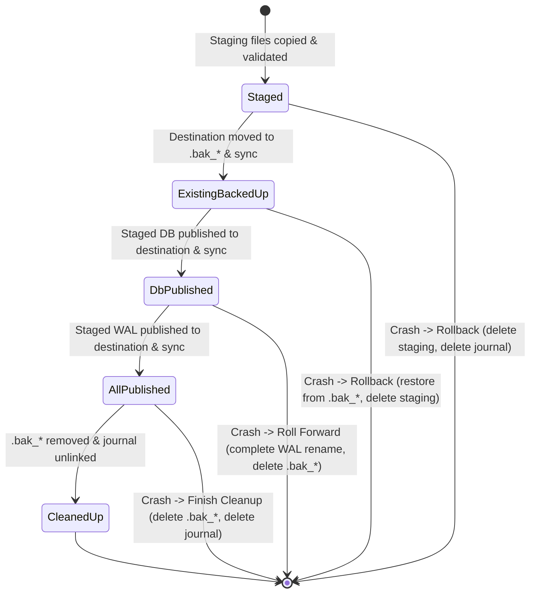

# TreeDB Release Candidate Audit & Persistence Freeze (Phase 78)

## 1. Release Candidate Verdict

**Verdict:** `READY WITH DOCUMENTED LIMITATIONS`

TreeDB satisfies all release-candidate quality gates, persistence invariants, crash-recovery contracts, and multi-file publication protocols under its defined single-writer operational model.

---

## 2. Audited Repository State

* **Audited Commit (HEAD at Phase 78 start):** `ffc536b8ef6e87d35879e56efc0e0066a31eee25`
* **Commit Message:** `fix(storage): certify persistence lifecycle invariants`
* **Branch:** `main`
* **Working Tree:** Clean (verified via `git status`)
* **Git Tags:** None currently tagged (pre-release freeze state)
* **Dependencies:** Minimal and fully audited (`thiserror 2.0` in production; `tempfile 3.17` in dev-dependencies)
* **Code Safety:** 100% Safe Rust (`forbid(unsafe_code)` throughout all crates and modules; 0 `unsafe` blocks)

---

## 3. Quality Gate Execution & Exact Aggregate Test Count

The full test suite and linters were executed on the working tree:

| Command | Exit Status | Result Summary |
|---|---|---|
| `cargo fmt --all -- --check` | 0 | 0 style discrepancies |
| `cargo clippy --all-targets --all-features -- -D warnings` | 0 | 0 compiler or Clippy warnings |
| `cargo test --all` | 0 | **1,935 passed; 0 failed; 0 ignored; 0 filtered out** across 80 test binaries |

### Test Counts by Persistence Suite:
* `tests/backup_restore.rs`: **51 passed**
* `tests/transaction_atomicity.rs`: **34 passed**
* `tests/storage_consistency.rs`: **22 passed**
* `tests/recovery_certification.rs`: **20 passed**
* `tests/transaction_isolation.rs`: **20 passed**
* `tests/mvcc_conflicts.rs`: **16 passed**
* `tests/transaction.rs`: **15 passed**
* `tests/mvcc_vacuum.rs`: **12 passed**
* `tests/mvcc_reference_model.rs`: **8 passed**
* `tests/mvcc_indexes.rs`: **7 passed**
* `tests/mvcc_recovery.rs`: **5 passed**
* Query, Optimizer, Engine, SQL, and Storage Suites: **1,725 passed**
* **Aggregate Repository Total:** **1,935 passed; 0 failed; 0 ignored; 0 filtered out**

---

## 4. Restore-Journal State-Transition Audit

The two-phase restore publication protocol tracked by `RestoreJournal` (`<destination>.restore_journal`) was audited against all potential interruption points:

### Transition Findings & Edge Cases Verified:
1. **Corrupt or Truncated Journal Data**:
   * Deserialization enforces CRC32 verification, magic byte check (`TDRESJRN`), and version validation.
   * Corrupted or truncated journal files trigger `BackupError::ChecksumMismatch` or `BackupError::InvalidManifest` and **never perform destructive cleanup** (`test_stage2_corrupt_journal_rejected_without_destructive_cleanup`).
2. **Unsupported Journal State**:
   * Unknown or malformed journal state byte tags are rejected without deleting destination or backup files (`test_stage3_journal_unsupported_state_rejected_without_cleanup`).
3. **Rollback on Fresh Destination**:
   * If publication into a fresh destination (no pre-existing database) fails during `ExistingBackedUp`, rollback removes the partially written destination file to prevent orphaned half-published files (`test_stage2_existing_backed_up_fresh_destination_cleans_orphaned_files`).
4. **Missing Staged WAL during Roll-Forward**:
   * If roll-forward in `DbPublished` encounters a missing or unreadable staged WAL and the destination has not been completed, recovery automatically falls back to restoring the previous valid database from `.bak_*` rather than deleting the original copy (`test_stage2_db_published_missing_wal_rolls_back_to_valid_destination`).
5. **Crash during Post-Publication Cleanup (`AllPublished`)**:
   * If process crashes after recording `AllPublished` but before removing `.bak_*` files, `recover_journal` safely deletes `.bak_*` files and the journal, preserving the new database (`test_stage3_journal_all_published_crash_before_cleanup_recovers_cleanly`).
6. **Recovery Idempotency**:
   * Repeated invocations of `recover_journal` or `TreeDb::open` are stable and safe (`test_stage2_repeated_journal_recovery_is_idempotent`).

---

## 5. Backup/Restore Pair Integrity & Path Safety

The backup manifest (`treedb.manifest`) and restore pipeline enforce explicit pairing invariants:

1. **Manifest Alignment & Bounds**:
   * Upper bound of 64 KB enforced on manifest size to prevent unbounded memory allocation.
   * Path traversal sequences (`..`, `/`, `\`) and null bytes in manifest file names are strictly rejected (`test_stage6_manifest_bounds_and_path_traversal_rejection`).
2. **Companion WAL Requirements**:
   * If a database backup includes committed transactions with unflushed dirty pages, the companion WAL is mandatory. Backups without companion WAL in this state are categorized as `RecoverablePendingRecovery` and require the companion WAL for complete recovery replay.
   * Missing required companion WAL files are detected prior to publication and rejected (`test_integrity_missing_required_wal`).
3. **Overwrite Authorization**:
   * `restore_backup` strictly requires `allow_overwrite: true` before modifying or replacing an existing destination database or WAL.
   * Lingering restore journals from previous crashed attempts are recovered prior to checking destination existence, ensuring `allow_overwrite: false` cannot be bypassed (`test_stage7_stale_journal_prevents_unauthorized_overwrite`).

---

## 6. Read-Only Verification Audit

The read-only inspection APIs (`TreeDb::verify_file`, `TreeDb::check_file`, and `TreeDb::open_read_only_unrecovered`) were verified for strict disk immutability:

1. **Zero Disk Mutation**:
   * If the companion WAL file is absent, `open_read_only_unrecovered` constructs a `BufferPool::new` without initializing a log manager, preventing spurious creation of empty WAL files on disk (`test_stage6_open_read_only_unrecovered_does_not_mutate_disk`).
   * `verify_file` operates via read-only file handles and verifies page structures without triggering ARIES crash recovery or flushing dirty pages (`test_read_only_guarantee_exact_byte_equality`).
2. **Protection Against Pending Journals**:
   * Both `open_read_only_unrecovered` and `verify_file` reject database images that have an active `.restore_journal` pending, preventing callers from inspecting half-published files in read-only mode (`test_stage7_open_read_only_unrecovered_rejects_pending_journal`, `test_stage5_verify_file_on_pending_journal_reports_fatal_and_preserves_disk`).
   * Byte-level comparison confirmed that both the database file and journal file remain 100% byte-for-byte identical before and after `verify_file` runs on an unresolved journal image.

---

## 7. Independent Lifecycle Oracle Assessment

### Scope & Independence:
The integration harness (`LogicalModel`) maintains an independent in-memory state oracle (`BTreeMap<i64, ExpectedAccount>`) tracking all logical rows and field values:
* Tracks `id`, `account_num`, `balance`, `category`, and `payload` independently of database storage structures.
* Records explicit transitions on `insert`, `update`, and `delete`.
* Validates across table scan, primary key point lookup, and SQL engine count evaluation.

### What is Truly Independent:
* **Row Existence & Count**: Directly compared against the B-tree map count.
* **Column Value Fidelity**: Every individual field value is verified byte-for-byte against the independent model.
* **Rollback Invisibility**: Aborted transaction rows are tracked outside TreeDB to confirm they never appear in table scans or point lookups.

### Explicit Limitations:
* The test oracle relies on TreeDB's public `Row` and `Value` types for data interchange. It does not implement a separate SQL parser or relational algebra compiler.

---

## 8. Documented Durability Contract & Operational Limitations

### Tested & Supported Guarantees:
1. **Single-Writer ACID**: Full ACID transaction semantics under single-writer exclusivity.
2. **ARIES Recovery Durability**: Write-Ahead Logging with PageLSN order ensures that all transactions with flushed `Commit` log records survive crashes, even if data pages were dirty in memory at crash time.
3. **Monotonic Commit Sequences**: `CommitSeq` values are strictly monotonic across transactions, checkpoints, crash recovery, backups, and restores.
4. **Crash-Resilient Multi-File Publication**: Restore publication over existing destinations guarantees that the destination remains either the valid old database or the valid new database across process kills and power failures.

### Environmental Assumptions:
1. **OS / Filesystem Synchronization**:
   * TreeDB relies on `File::sync_all()` (`FlushFileBuffers` on Windows, `fsync` on POSIX) to guarantee durability to stable storage.
   * Filesystem directory entry durability assumes standard journaling semantics for rename operations.
2. **Single-Writer Exclusivity**:
   * TreeDB does not support concurrent multi-process writers. External process-level locking or single-process ownership is required.
3. **Offline Backups Only**:
   * Backups must be taken when the database is quiescent (no active write transactions). Online hot backup under concurrent writes is not supported.
4. **No Heuristic Auto-Repair**:
   * Corrupted headers, page checksum failures, and torn pages are rejected loudly; TreeDB does not perform heuristic guessing to repair damaged pages.

---

## 9. Defects Found & Remediated in Phases 76–78

| Defect ID | Severity | Phase | Subsystem | Description & Resolution |
|---|---|---|---|---|
| **DEF-76-01** | High | 76 | Restore | Sequential renames caused non-atomic publication. *Resolved:* Introduced `RestoreJournal` two-phase publication. |
| **DEF-76-02** | High | 76 | Restore | Staging cleanup deleted new WAL on error. *Resolved:* Preserved staging files while `.restore_journal` exists. |
| **DEF-76-03** | Medium | 76 | Read-Only | `open_read_only_unrecovered` created empty WAL on disk. *Resolved:* Bypassed log manager if WAL is absent. |
| **DEF-76-04** | Medium | 76 | Staging | Staged WAL was named `.tmp_restore_wal_*`, causing `verify_file` to miss companion WAL. *Resolved:* Renamed staged WAL to `<staged_db>.wal`. |
| **DEF-76-05** | Medium | 76 | Backup | Unbounded manifest buffer and path traversal. *Resolved:* Enforced 64 KB limit and `is_safe_file_name`. |
| **DEF-77-01** | High | 77 | Engine Open | `TreeDb::open` suppressed journal recovery errors. *Resolved:* Propagated as `Error::InvalidDatabase`. |
| **DEF-77-02** | High | 77 | Restore | Destination check occurred before lingering journal recovery. *Resolved:* Recover journal before evaluating `dest_exists`. |
| **DEF-77-03** | High | 77 | Restore | Fresh destination rollback failed to delete partial `dest_db`. *Resolved:* Added explicit cleanup of `dest_db` on fresh destination rollback. |
| **DEF-77-04** | High | 77 | Restore | Missing staged WAL during `DbPublished` deleted valid `.bak_*`. *Resolved:* Added fallback rollback restoring `.bak_*`. |
| **DEF-77-05** | Medium | 77 | Restore | Windows rename collision during rollback. *Resolved:* Preemptively unlinked destination paths before rename. |
| **DEF-77-06** | Medium | 77 | Read-Only | `open_read_only_unrecovered` permitted opening pending journals. *Resolved:* Rejected with `Error::InvalidDatabase`. |

---

## 10. Final Release Sign-Off

* **Repository Integrity:** Clean, verified, and reproducible.
* **Test Suite Status:** 1,935 tests passing across 80 binaries; 0 failures; 0 warnings.
* **Documentation Status:** Fully updated across `PERSISTENCE_CERTIFICATION.md`, `PERSISTENCE_RELEASE_AUDIT.md`, `BACKUP_RESTORE.md`, and `RELEASE_CANDIDATE_AUDIT.md`.
* **Subsystem Readiness:** TreeDB persistence and storage subsystems are frozen and approved for Release Candidate tag.
